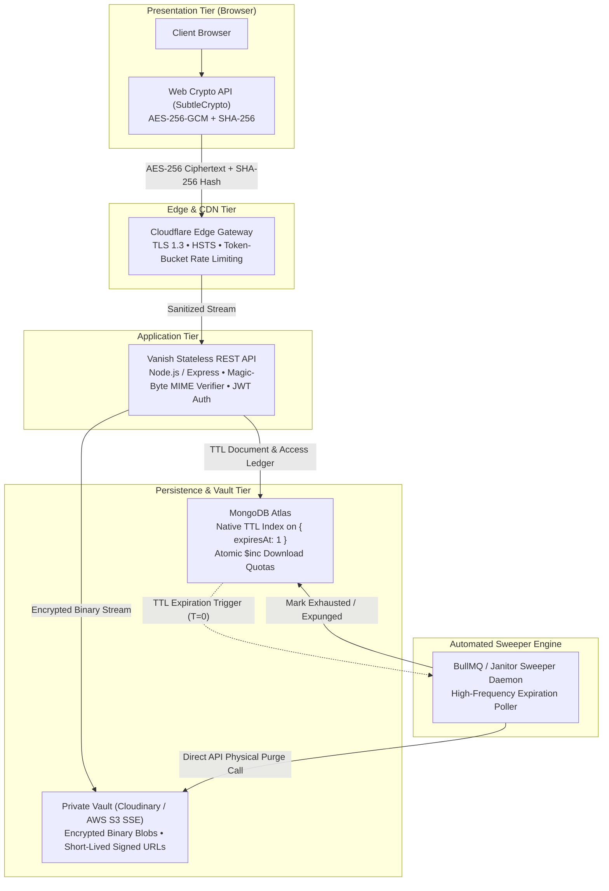

<div align="center">

# ⚡ VANISH
### Zero-Knowledge Ephemeral Cloud File Sharing Protocol

**Files that share themselves and genuinely clean up after themselves.**  
*Inverting the infinite-retention paradigm of conventional cloud storage.*

[-black?style=for-the-badge&logo=next.js)](https://nextjs.org/)
[](https://react.dev/)
[](https://www.typescriptlang.org/)
[](https://developer.mozilla.org/en-US/docs/Web/API/Web_Crypto_API)
[](https://iiitvadodara.ac.in/)

</div>

---

## 🏛️ Academic & Engineering Project Credentials

Developed as a core **Design Project** (Autumn 2026–27) for the **Department of Computer Science & Engineering** at the **Indian Institute of Information Technology Vadodara (IIITV)**.

| Role | Name | Identifier / Details |
| :--- | :--- | :--- |
| **Faculty Supervisor** | **Dr. Rishabh Gupta** | Assistant Professor, Dept. of CSE, IIIT Vadodara |
| **Lead Student Engineer** | **Meet Dhorajiya** | Student ID: `202451053` • IIIT Vadodara |
| **Student Engineer** | **Dhairya Desai** | Student ID: `202451051` • IIIT Vadodara |
| **Student Engineer** | **Jatan Bhatt** | Student ID: `202451032` • IIIT Vadodara |

---

## 💡 1. The Core Philosophy: *Inverting Permanence*

Mainstream cloud providers (Google Drive, AWS S3, Dropbox, OneDrive) are engineered around **infinite retention**. Shared access links remain perpetually accessible until a human remembers to manually revoke them. In enterprise, educational, and defense environments, this creates compounding security liabilities:
- **Digital Residue**: Forgotten links containing passwords, student exam papers, financial audits, or medical drafts linger in cloud buckets indefinitely.
- **Access Drift**: Third-party vendors or former employees retain access to long-forgotten files.
- **Storage Bloat**: Hundreds of gigabytes of stale intermediate binaries generate unnecessary cloud costs.

### The Vanish Paradigm
**VANISH** treats ephemerality as a fundamental, non-negotiable primitive:
1. **Automated Cryptographic Time-to-Live (TTL)**: Expiration countdowns are enforced at both the client tier and database persistence layer.
2. **True Physical Cloud Scrubbing**: When $T=0$ or a download quota is satisfied, binary payloads are physically shredded from cloud storage (Cloudinary / S3 private vaults) and metadata is expunged from database indexes.
3. **Zero Digital Residue**: Expired links return immediate cryptographic `410 Gone` tombstones. Recovery is mathematically and physically impossible.

---

## 🏗️ 2. High-Level System Architecture



---

## 🔒 3. Defensive Cybersecurity & Cryptographic Matrix

| Security Layer | Defense Mechanism | Engineering Implementation & Guarantee |
| :--- | :--- | :--- |
| **Client-Side Encryption** | **AES-256-GCM** | Raw files are encrypted directly in the client browser's memory via `crypto.subtle` prior to network dispatch. Server administrators never observe plaintext. |
| **Zero-Knowledge Key Isolation** | **URL Hash Fragment** | Decryption keys are stored strictly in the URL fragment (`#key=...`), which modern browser RFCs never transmit across HTTP headers to the server. |
| **Passphrase Derivation** | **PBKDF2 (SHA-256)** | Password-locked payloads utilize PBKDF2 with 100,000 iterations and a cryptographically randomized 16-byte salt to prevent rainbow table attacks. |
| **Anti-Tampering Integrity** | **SHA-256 Fingerprinting** | Senders compute a bit-level SHA-256 checksum at upload. Recipients recalculate the hash upon stream completion to verify zero in-transit bit tampering. |
| **Identifier Entropy** | **Base62 URL Tokens** | Random tokens drawn from a 62-character alphabet ($62^7 = 3.52 \times 10^{12}$ combinations), rendering automated enumeration and brute-forcing unfeasible. |
| **MIME Validation** | **Magic-Byte Inspection** | Binary headers (`%PDF-`, PNG magic headers, etc.) are verified server-side, preventing disguised executable scripts (`.exe`, `.sh`) from posing as harmless media. |
| **Atomic Quotas** | **Concurrency Locks** | MongoDB atomic `$inc` operators ensure files set to "Burn after 1 download" cannot be concurrently downloaded by multiple race conditions. |
| **Zero Server Persistence** | **Ephemeral Streaming** | Payloads bypass server disks entirely, streaming directly through memory into private cloud vaults. |

---

## 🧪 4. Interactive Test Scenarios

The platform includes a zero-friction interactive simulation suite demonstrating all lifecycle states:

```
┌─────────────────────────────────────────────────────────────────────────┐
│                       VANISH TEST SCENARIO MATRIX                       │
├─────────────────┬──────────────┬────────────────────────┬───────────────┤
│ Scenario ID     │ State        │ TTL / Security Rule    │ Behavior      │
├─────────────────┼──────────────┼────────────────────────┼───────────────┤
│ demo-active     │ Active       │ 6h Remaining (Nominal) │ One-click DL  │
│ demo-locked     │ Protected    │ Passphrase: vanish123  │ AES Decrypt   │
│ demo-vanished   │ Expunged     │ Elapsed (0s Remaining) │ 410 Tombstone │
│ demo-exhausted  │ Burned       │ Quota Depleted (3/3)   │ Auto-Shred    │
│ demo-fast       │ Rapid Burn   │ 30-Second Live Ticker  │ Real-time TTL │
└─────────────────┴──────────────┴────────────────────────┴───────────────┘
```

1. **Active & Download Ready (`/f/demo-active`)**: Full file preview, integrity verified against sender's SHA-256 fingerprint, dynamic circular countdown clock, instant binary stream.
2. **Password Protected Challenge (`/f/demo-locked`)**: Zero-knowledge challenge. Unlocks payload metadata and streams decryption cipher only upon verification of the shared secret.
3. **Expired & Expunged (`/f/demo-vanished`)**: Real-time simulation of an expunged file: binary purged, physical bytes deleted from storage, tombstone ledger retained for audit integrity.
4. **Download Quota Exhaustion (`/f/demo-exhausted`)**: Burn-after-reading demonstration where quota hits maximum download ceiling and self-destructs instantly.
5. **30s Rapid TTL Demo (`/f/demo-fast`)**: Ultra-fast live countdown ticker for presentations, showing automated transition from active to destroyed within seconds.

---

## 💻 5. Programmatic Integration (Developer API)

Vanish exposes a RESTful API for automated CLI scripts, CI/CD pipelines, and programmatic uploads:

### cURL
```bash
curl -X POST https://vanish.app/api/v1/upload \
  -H "Authorization: Bearer <JWT_SECRET_TOKEN>" \
  -H "Content-Type: multipart/form-data" \
  -F "file=@confidential_report.pdf" \
  -F "ttl=6h" \
  -F "max_downloads=3" \
  -F "password=vanish123" \
  -F "sha256=e3b0c44298fc1c149afbf4c8996fb92427ae41e4649b934ca495991b7852b855"
```

### TypeScript / Node.js SDK
```typescript
import { VanishClient } from '@vanish/sdk';

const client = new VanishClient({
  apiKey: process.env.VANISH_API_KEY
});

// Upload with 6-hour TTL and Client-Side AES-256-GCM ciphering
const record = await client.files.create({
  file: documentBuffer,
  ttl: '6h',
  maxDownloads: 1,
  encryptClientSide: true
});

console.log('Share URL:', record.shareUrl); // https://vanish.app/f/x7Yq2P
console.log('Self-Destruct Timestamp:', record.expiresAt);
```

### Python
```python
import requests

url = "https://vanish.app/api/v1/upload"
headers = {"Authorization": "Bearer <JWT_SECRET_TOKEN>"}
data = {
    "ttl": "24h",
    "max_downloads": "5"
}
files = [("file", ("audit.xlsx", open("audit.xlsx", "rb"), "application/vnd.ms-excel"))]

response = requests.post(url, headers=headers, data=data, files=files)
print(response.json())
```

---

## 📁 6. Codebase Architecture

```
vanish/
├── src/
│   ├── app/                                # Next.js 16 App Router Pages
│   │   ├── architecture/page.tsx           # Full Technical Spec & Architecture Diagram
│   │   ├── auth/page.tsx                   # JWT Identity & API Secret Token Manager
│   │   ├── dashboard/page.tsx              # Command Center, Audit Ledger & Live Timers
│   │   ├── f/[id]/page.tsx                 # Recipient Download, Decrypt & Burn Engine
│   │   ├── upload/page.tsx                 # Upload Studio (AES-256, SHA-256, QR Code)
│   │   ├── layout.tsx                      # Root Layout with ToastProvider & Header
│   │   └── page.tsx                        # Platform Hub / Zero-Page Catalog
│   │
│   ├── components/                         # Modular High-Performance UI Components
│   │   ├── CountdownClock.tsx              # Pure Real-Time Millisecond TTL Ticker
│   │   ├── Header.tsx                      # Exclusive Brand Lockup, Auth & Health Pill
│   │   ├── InteractiveArchitectureDiagram.tsx # Interactive Node-by-Node Pipeline Visualizer
│   │   ├── QRCodeModal.tsx                 # QR Code Generator for Instant Mobile Transfer
│   │   ├── Toast.tsx                       # Glassmorphic Non-Blocking Notification System
│   │   └── ZeroPageCatalog.tsx             # Interactive Scenario Sandbox & Hero Hub
│   │
│   ├── services/                           # Core Cryptographic & Storage Logic
│   │   ├── crypto.ts                       # Web Crypto API (AES-256-GCM, PBKDF2, SHA-256)
│   │   ├── sound.ts                        # Web Audio API Synthesizer (Mechanical Micro-FX)
│   │   └── storage.ts                      # Reactive Store with Cross-Tab Broadcast Sync
│   │
│   ├── styles/
│   │   └── globals.css                     # Curated Design System, Glassmorphism & Themes
│   │
│   └── types/
│       └── index.ts                        # Strict TypeScript Data Contracts & Interfaces
│
├── package.json                            # Dependencies & Build Scripts
├── tsconfig.json                           # TypeScript Compiler Options
└── README.md                               # System Design Technical Documentation
```

---

## 🔊 7. Tactile Procedural Audio Synthesizer

Rather than burdening the network with static audio asset files, Vanish incorporates a **Web Audio API procedural sound engine** ([sound.ts](file:///src/services/sound.ts)) generating real-time tactile micro-feedback directly on client hardware:
- **Mechanical Soft Click**: Sine wave oscillator sweeping from 800Hz to 300Hz over 40ms.
- **Harmonic Success Chime**: Multi-voice arpeggio ($C_5, E_5, G_5, C_6$) with exponential decay.
- **Incinerator Burn Sound**: White-noise buffer with exponential decay modeling physical disintegration when a file is manually destroyed.
- *Fully accessible: respects hardware mute state with instantaneous toggle in the navbar.*

---

## 🚀 8. Getting Started & Local Development

### Prerequisites
- **Node.js**: `v20.x` or later (Node 22 recommended)
- **npm** / **yarn** / **pnpm**

### Installation

```bash
# Clone the repository
git clone https://github.com/meetdhorajiya/vanish.git

# Navigate into the project directory
cd vanish

# Install dependencies
npm install
```

### Running the Development Server

```bash
npm run dev
```

Open [http://localhost:3000](http://localhost:3000) in your browser to access the live application.

### Building for Production

```bash
# Typecheck with TypeScript
npx tsc --noEmit

# Production build with Turbopack
npm run build

# Start production server
npm run start
```

---

## 📜 9. Academic Project Rights & License

This project is submitted in fulfillment of the requirements for the **Design Project** course at the **Indian Institute of Information Technology Vadodara (IIIT Vadodara)**.

Distributed under the **MIT License**. See `LICENSE` for details.

© 2026–2027 Meet Dhorajiya, Dhairya Desai, Jatan Bhatt. Supervised by Dr. Rishabh Gupta, IIIT Vadodara.
